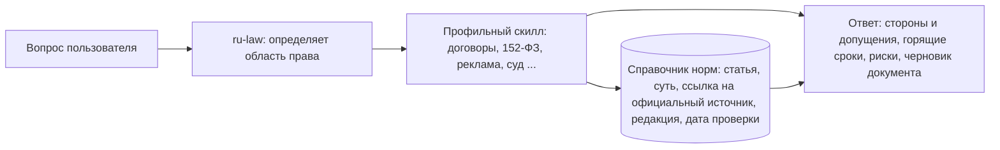

# ru-law-skills

**Российское право для ИИ-агентов, где нормы сверены с официальными текстами, а не угаданы по памяти.**


Набор из 11 скиллов для Claude, Hermes и других агентов, которые понимают формат Agent Skills (папка с `SKILL.md`). Он помогает проверять и составлять договоры, соблюдать 152-ФЗ, писать оферты, проверять рекламу, разбираться с авторским правом и товарными знаками, трудовыми вопросами, претензиями и судами.

> **Скилл — всем в помощь. Предназначен только для граждан РФ:** он опирается на право Российской Федерации.

> Ответы скиллов — **черновики для проверки юристом**, а не юридическая консультация. Подробности и ограничения — в конце.

---

## Зачем это нужно

Обычная языковая модель отвечает на юридические вопросы уверенно и гладко, но по памяти. Поэтому она:

- называет **статью, которой нет**, или номер судебного дела, которого не существует;
- путает **суммы штрафов и пошлин**: законы меняются, а модель помнит старые цифры;
- применяет **не ту редакцию** закона или забывает, что норма уже изменена;
- не замечает **срок, который горит** (давность, претензионный порядок, обжалование).

В бытовом вопросе («нам не платят», «можно ли такую рассылку?») такая ошибка стоит денег. Этот набор устроен так, чтобы агент **не выдумывал, а проверял**.

## Как это работает



1. **Маршрутизатор `ru-law`** определяет, к какой области относится вопрос, и направляет в нужный скилл. Если задача на стыке (например, договор с разработчиком: договор + авторское право + персональные данные), он ведёт по порядку.
2. **Профильный скилл** задаёт только те вопросы, без которых нельзя ответить, идёт по пошаговому алгоритму и чек-листу и собирает результат в понятном виде.
3. **Справочник норм** (`references/norms.md`) — основа ответа. Каждая строка: статья, суть своими словами, **ссылка на официальный источник**, редакция и **дата, когда норму реально открыли и сверили**. Агенту разрешено называть только статьи из справочника или те, что он открыл прямо сейчас.
4. **Скрипт проверки** (`scripts/check.py`) не пропустит справочник без источника и даты, предупредит об устаревших нормах (старше 90 дней) и о близких будущих изменениях.

### Правила, общие для всех скиллов

В каждый скилл вписаны одни и те же 12 правил ([`shared/core-rules.md`](shared/core-rules.md)). Главные:

| Правило | Что значит на практике |
|---|---|
| Не выдумывай нормы | Статья только из справочника или открытая сейчас на официальном сайте; иначе «норму нужно уточнить» |
| Цифры только из источника | Штрафы, пошлины, сроки — не по памяти |
| Редакция на дату события | Спор оценивают по закону, который действовал, когда подписали договор или случилось нарушение |
| Устаревшее перепроверь | Норма старше 3 месяцев или с отмеченными будущими изменениями — сверить до ответа |
| Расхождение — верь открытому тексту | Если сайт отличается от справочника, агент говорит об этом и не смешивает редакции |
| Сроки вперёд | Всё, что может истечь, — в начало ответа |
| Не додумывай факты | Нужных данных нет — спросить или явно перечислить допущения |

## Пример

**Вопрос:** «Нам должна фирма из Екатеринбурга 450 000 ₽, мы из Новосибирска, претензию отправили 35 дней назад. Куда подавать?»

**Что делает скилл `ru-lawsuit`** (ответ сокращён):

- **Стороны:** истец — вы (Новосибирск), ответчик — должник (Екатеринбург). Скилл проговаривает это *до* выбора суда: именно здесь легко перепутать, кто кому должен.
- **Срок:** претензионный порядок выдержан — 30 дней со дня отправки (АПК РФ ст. 4 ч. 5), если договор не устанавливает другое.
- **Суд:** Арбитражный суд Свердловской области — по месту ответчика (ст. 35 АПК), если в договоре нет иной подсудности (ст. 37).
- **Пошлина:** 27 500 ₽ = 10 000 + 5% × (450 000 − 100 000) — по НК РФ ст. 333.21, ставки с 09.09.2024, дата сверки указана.
- **Дальше:** проект иска с заглушками, список приложений, чего может не хватать, и напоминание, что это черновик для юриста.

## Что внутри

| Скилл | Для чего | Типичный вопрос | Норм |
|---|---|---|---|
| `ru-law` | Маршрутизатор: определяет область и ведёт в нужный скилл | «Это вообще законно?» | — |
| `ru-contract-review` | Проверка договора: риски, ничтожные условия, протокол разногласий | «Подрядчик прислал договор, можно подписывать?» | 46 |
| `ru-contract-draft` | Составление договоров: поставка, услуги, подряд, аренда, NDA, лицензия | «Нужен договор с разработчиком» | 31 |
| `ru-personal-data` | 152-ФЗ: политика, согласия, Роскомнадзор, локализация, утечки | «У нас утекла база клиентов» | 21 |
| `ru-online-terms` | Оферта, пользовательское соглашение, подписки, возвраты | «Нужна оферта для интернет-магазина» | 19 |
| `ru-advertising` | 38-ФЗ: что считается рекламой, маркировка, рассылки, блогеры | «Можно ли рассылать старым клиентам?» | 14 |
| `ru-copyright` | Права на контент, код, картины; лицензии; нарушения | «Можно взять картинку из интернета?» | 25 |
| `ru-trademark` | Товарные знаки, МКТУ, регистрация, споры | «Как проверить, что название свободно?» | 19 |
| `ru-employment` | Найм, увольнение, ГПХ и самозанятые | «Как уволить того, кто опаздывает?» | 31 |
| `ru-pretrial-claim` | Досудебная претензия, расчёт неустойки и процентов | «Клиент не платит два месяца» | 17 |
| `ru-lawsuit` | Иск, подсудность, госпошлина, отзыв на иск | «В какой суд подавать и сколько пошлина?» | 30 |

Всего **253 нормы** в справочниках. Есть шаблоны документов: претензия, ответ на претензию, протокол разногласий, политика обработки персональных данных, согласие на обработку, уведомление Роскомнадзора, согласие на рассылку, претензия о нарушении авторских прав.

## Установка

Подробные шаги для каждой программы — в [`INSTALL.md`](INSTALL.md). Коротко:

**Claude Code**

```
/plugin marketplace add <путь или адрес репозитория>
/plugin install ru-law@ru-law-skills
```

**Чат (claude.ai, приложение Claude)** — загрузите папки из `skills/` как zip-архивы (по одному на скилл, все 11) и создайте проект со строкой-триггером в инструкциях.

**Hermes Agent и другие агенты** — скопируйте папки из `skills/` в папку скиллов агента.

### Чтобы скилл включался

Модель сама решает, открывать ли скилл, и на короткий бытовой вопрос иногда отвечает по памяти. Надёжнее всего добавить в инструкции (проект в чате, `CLAUDE.md`, `AGENTS.md`) одну строку:

> Если вопрос касается права РФ (договоры, штрафы, суды, увольнения, персональные данные, реклама, авторские права, товарные знаки, претензии, иски), перед ответом вызови скилл `ru-law` и работай по нему. Суммы штрафов, пошлины и сроки не называй по памяти.

В Claude Code плагин дополнительно ставит хук, который подсказывает модели то же самое при юридических словах в вопросе.

## Как это проверялось

Мы стараемся не обещать лишнего, поэтому вот что именно сделано и что найдено:

- **Нормы.** Каждая из 253 норм открыта на официальном источнике (КонсультантПлюс, Гарант, pravo.gov.ru, cbr.ru) 18–19 ноября 2026 г.; в справочнике указаны редакция и дата.
- **Независимая проверка.** Отдельный агент выборочно пересверил 30 норм: 25 оказались полностью верны, 2 неточны, **3 содержали ошибки** (дата ключевой ставки, сломанная ссылка, неверно описанная часть статьи о штрафах за утечку). Прогон тестовых задач показал ещё одну ошибку в логике (скилл перепутал истца и ответчика). Всё исправлено в версии 0.1.1.
- **Самооценка автора завышена.** Автор скиллов поставил своим тестам 100%, независимая проверка этого не подтвердила, поэтому перед каждым релизом нужна проверка другим агентом. Полный отчёт — [`tests/INDEPENDENT_REVIEW.md`](tests/INDEPENDENT_REVIEW.md).
- **Hermes Agent.** 46 запусков: без строки-триггера нужный скилл открыт в 10 из 11 вопросов, со строкой — в 32 из 33; две содержательные задачи решены верно ([`tests/HERMES_TRIGGERS.md`](tests/HERMES_TRIGGERS.md)).
- **Выдуманных норм не найдено.** В семи ответах, которые мы разобрали построчно, скиллы не назвали ни статью, ни дело, ни цифру, которых нет в справочнике: где нормы нет, они пишут «нужно уточнить». Но ошибка *в самом справочнике* передаётся в ответ как факт, поэтому справочники нужно сверять регулярно.

## Ограничения

- **Это не юридическая консультация.** Результат — черновик. Если на кону суд, крупная сумма, административная или уголовная ответственность, обратитесь к юристу.
- **Только право РФ.** Иностранный элемент, банкротство, налоговые проверки и уголовные дела — вне рамок.
- **Законы меняются.** Дата сверки указана в каждой строке справочника. Ближайшие пересверки: статьи 1234, 1235, 1296 ГК РФ после 01.01.2027 и 152-ФЗ в 2027 году (`check.py` напомнит сам).
- **Включение скилла вероятностно.** В Claude Code и в claude.ai после последних изменений срабатывание не проверялось; до них в Claude Code (около 200 установленных скиллов) скилл открывался примерно в трети бытовых вопросов. Помогает строка-триггер.
- **Проверено на одной модели в Hermes** (DeepSeek V4 Pro), по одному запуску на вопрос.

## Как помочь

Нашли устаревшую или неверную норму? Откройте issue и приложите **ссылку на официальный источник**: так мы сможем быстро проверить и поправить справочник.

Хотите добавить скилл или область (например, недвижимость, налоги, госзакупки)?

- Прочитайте [`AGENTS.md`](AGENTS.md): там описано, как устроен проект, как сверять нормы и как проверять скилл.
- Нормы добавляйте только со ссылкой на официальный источник и датой проверки, по памяти — нельзя.
- Перед коммитом запустите `python scripts/check.py`; перед релизом — `python scripts/check.py --release`.

Структура репозитория:

```
skills/              11 скиллов: SKILL.md, references/ (справочники норм), assets/ (шаблоны)
shared/core-rules.md общие правила, которые скрипт вписывает во все скиллы
hooks/               хук для Claude Code
scripts/check.py     проверка справочников и скиллов
tests/               тестовые задачи, результаты и отчёты независимой проверки
INSTALL.md           установка и строка-триггер
AGENTS.md            инструкция для агентов и контрибьюторов
```

## Лицензия

Apache License 2.0 — см. [`LICENSE`](LICENSE). Проект не связан с государственными органами и справочно-правовыми системами. Тексты законов не воспроизводятся: в справочниках — краткий пересказ и ссылка на официальный источник.
